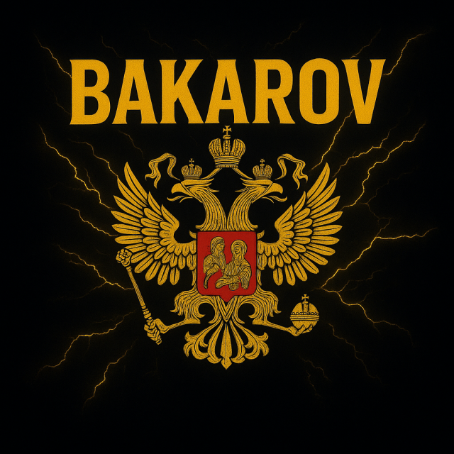

# Bakarov — Discord-bot voor Future RP

## Beveiligingssysteem — 2.5.16

In de hoofdserver **`1555685630640652338`** is de **+-rol `1555685630770413643`** de enige uitzonderingsrol. Alleen leden met deze rol zijn vrijgesteld van automatische beveiligingsacties. De uitzonderingsrol en status zijn zichtbaar in **Modules instellen → Beveiliging & automatisch modereren** en **Botstatus**.

- Een linkbericht van een ander lid wordt altijd verwijderd. Een tweede linkbericht binnen de ingestelde periode, of meerdere links in één bericht, leidt tot een ban. De bot verwijdert ook eerdere linkberichten die hij nog kan bereiken.
- Eén tot drie tags zijn toegestaan. Vier of meer tags, of `@everyone`/`@here`, verwijdert het bericht en leidt tot een ban.
- Schelden en spam verwijderen de betrokken berichten en geven een time-out. Herhaling verhoogt die standaard van 10 minuten naar 30 minuten, 60 minuten en daarna maximaal 24 uur. Herhaalde overtredingen tellen 30 dagen mee.
- Acht nieuwe leden binnen tien seconden signaleren een mogelijke raid. Volgende toetreders krijgen tijdelijk een time-out en de gebeurtenis komt in de botlogs.
- Een onbevoegde kanaal-, kanaalrechten-, rol-, webhook-, uitnodigings- of serverwijziging, bulkverwijdering, kick, ban of time-out leidt tot een ban van de uitvoerder. De uitzonderingsrol mag deze acties uitvoeren.

De standaarddrempels en time-outs zijn aanpasbaar via het dashboard. Beveiliging vereist voor de bot **View Audit Log**, **Manage Messages**, **Moderate Members** en **Ban Members**; zet de botrol ook boven de rollen die hij moet kunnen straffen. Als deze rechten of de uitzonderingsrol ontbreken, meldt de bot dat in de console en bij **Botstatus**. Discord registreert alleen uitgevoerde acties; een geblokkeerde, mislukte poging is niet zichtbaar in het auditlog.

## Gepubliceerde activiteitencheck overnemen — 2.5.3

De activiteitencheck met deadline **23 oktober 2026, 07:30 Belgische tijd** is al in mededelingen geplaatst. Deze versie neemt bij opstarten hetzelfde bericht over via de privé herstelregistratie. Alleen de oorspronkelijke ledensnapshot telt mee. De bot controleert afzender, kanaal, berichtkenmerken, deadline, privacy en leesrechten en haalt bestaande ✅-reacties op vóór de deadlinecontrole.

Wanneer een oorspronkelijk lid daarna met ✅ reageert, wordt hetzelfde bericht direct bijgewerkt met de nieuwe teller en de lijst met bevestigde leden. De bevestiging blijft bewaard, ook als het lid later zijn reactie verwijdert.

Reeds opgeslagen, gesloten of geannuleerde checks worden niet overschreven. Bij conflicten of ontbrekende rechten wacht het herstel; er wordt geen vervangende check gefabriceerd. Als deze versie pas na de deadline wordt gestart, wordt de verlopen, nog niet gekoppelde check niet achteraf geïmporteerd om gangwarns te maken.

## Bestemming en gangpotoverzicht — 2.5.1

De vaste bestemming voor de wekelijkse activiteitencheck is **mededelingen, 1555685632704249932**. De oude standaard in planning wordt eenmalig aangepast; latere eigen dashboardkeuzes blijven bewaard. Een bestaande open weekcheck wordt met hetzelfde check-ID opnieuw geplaatst. Opgeslagen bevestigingen en gemiste vinkjes uit het oude bericht blijven behouden. Het oude bericht verdwijnt pas nadat de vervanging en de nieuwe koppeling zijn opgeslagen. Bij een tijdelijke fout wordt de overdracht herhaald zonder dubbele check.

De vaste gangpot-embed toont **Totaal witgeld**, **Totaal zwartgeld** en **Items** als grote koppen, met de actuele bedragen en aantallen. Het overzicht met betaalde weekbijdragen staat eronder. De titel en totalen passen zich aan de echte registraties aan; voorbeeldbedragen worden niet geboekt.

## Wekelijkse check en gangpotvoorraad — 2.5.0

De automatische activiteitencheck heeft vanaf **vrijdag 23-10-2026 om 07:30 Belgische tijd** zijn eerste deadline. Daarna wordt standaard om de **twee weken** een volgende check geopend in mededelingen (`1555685632704249932`) met de reden **Tweewekelijkse activiteitencheck**. Bakarov wordt getagd en leden reageren met ✅. Na de deadline blijft de bestaande controle gelden: maximaal één gangwarn zonder tijdige bevestiging of goedgekeurde afwezigheidsperiode. Een losse planningsafmelding geeft geen vrijstelling.

De startdatum, tijd, reden, het kanaal, interval (1–12 weken) en aan/uit zijn te wijzigen bij **Modules instellen → Activiteitencheck & herinneringen**. De weekdag volgt uit de startdatum. Annuleren met `/activiteitencheck-stop` stopt alleen de lopende check; zet de automatische instelling uit om ook volgende checks te stoppen. Herstarts dupliceren geen check en gemiste, nog nooit gepubliceerde checks worden overgeslagen.

Gangpotvoorraad voor de leiding:

- `/gangpot item naam:repairkit aantal:5` voegt vijf repairkits toe. Gebruik `actie:Opnemen` voor een opname.
- `/gangpot zwartgeld bedrag:25000` voegt €25.000 in-game zwartgeld toe. Ook hier kun je `actie:Opnemen` kiezen.
- `/gangpot voorraad-correctie id:... reden:...` trekt een verkeerde registratie in met behoud van historie.

Dezelfde functies staan bij **Gangpot → Zwartgeld & items** in het dashboard. Het vaste totaalbericht toont gewoon geld, zwartgeld en itemvoorraden apart. Alle geldbedragen gebruiken **€**; bestaande bedragen zijn niet omgerekend. Items en zwartgeld voldoen niet aan de verplichte weekbijdrage en beïnvloeden geen fun-coins. Alleen werkelijk ontvangen of opgenomen in-game middelen horen in deze administratie.

## Afmeldingen en transcripts — 2.4.0

Planningsafmeldingen gelden uitsluitend voor de gekozen activiteit, nooit als gangpotvrijstelling. Geef een reden via het paneel of `/afmelden planning reden`. Duidelijke redenen zoals school, training, hobby, gym of een kapotte pc kan de bot herkennen en goedkeuren. De bot controleert niet of de opgegeven reden waar is; twijfelgevallen blijven bij Lead. Lead kan een botgoedkeuring intrekken en automatische goedkeuring uitschakelen via Modules instellen.

Alleen een door Lead goedgekeurde afwezigheidsperiode geeft gangpotvrijstelling voor de betrokken weken. Ontbrekende vrijstellingen worden vóór de betaalcontrole hersteld; gekoppelde automatische betaalwarns worden ingetrokken met groene log en DM. Een door Lead ingetrokken vrijstelling blijft ingetrokken.

De transcriptviewer past de Bakarov-naam, het logo en de zwart-gouden huisstijl ook toe op bestaande opgeslagen gesprekken. Oorspronkelijke berichten en namen blijven bewaard. Nieuwe HTML-exports hebben de nieuwe huisstijl. Reeds gedownloade bestanden of Discord-bijlagen veranderen niet vanzelf; via de viewer kun je een vernieuwde HTML downloaden.

## Bakarov-versies en correctie van aannamewarns — 2.3.1

Vanaf de rename naar Bakarov begint de versiereeks bij **2.0.0**. De latere updates zijn doorgerekend: overzichten en bezwaren 2.1.x, Discord-login 2.2.x en instapvrijstelling 2.3.x. De huidige versie is **2.5.3**.

Bij de gangpotcontrole gebruikt de bot nu ook de opgeslagen aangenomen sollicitaties uit de community-guild als bewijs van toetreding. Een bestaande automatische gangpotwarn uit de instapweek wordt ingetrokken met een groene melding in het ingestelde gangwarnkanaal en een DM. Een herstart geeft geen dubbele intrekking. Bestaande verplichtingen van eerdere gangleden, handmatige warns en latere volledige betaaltermijnen worden niet kwijtgescholden. Bewaar de volledige `data/`-map van beide guilds.


## Gangpot voor nieuwe leden — 2.3.0

De instapweek van een nieuw ganglid is vrijgesteld. De verplichte weekbijdrage begint bij de volgende volledige gangpottermijn. De instapweek geeft geen automatische gangpotwarn of betaalherinnering; een vrijwillige betaling blijft mogelijk. `/gangpot status` en het dashboard tonen de vrijstelling en startdatum. De eerste vastgelegde betaalplicht blijft bewaard bij herstarts; een ledenrol weghalen en teruggeven start geen nieuwe vrijstelling.

Bij de update blijven bestaande betaalverplichtingen intact. Een vastgelegde roltoekenning of Discord-toetreding kan aantonen dat iemand pas in een termijn lid werd. Alleen de gekoppelde automatische gangpotwarn voor zo'n instapweek wordt dan ingetrokken, met log en DM. Zonder bewijs van nieuwe toetreding worden bestaande leden niet algemeen vrijgesteld. Nieuwe leden die de bot na een offline periode voor het eerst aantreft krijgen vanaf die registratie een instapweek. Discord levert geen historisch tijdstip van een roltoekenning; de bot legt nieuwe toekenningen daarom zelf vast.


## Inloggen met Discord — 2.2.0

Open het dashboard en klik **Inloggen met Discord**. Je eigen Discord-account en je actuele **Legion Lead-rol** bepalen de toegang. In de hoofdserver is dat rol `1555685630707769382`; in de community is dat de ingestelde Lead-rol `1555726440933363761`. Je ziet alleen de servers waar je die rol hebt. Administrator zonder Lead-rol geeft geen toegang. Een verloren Lead-rol blokkeert ook een bestaande sessie.

Stel eenmalig de private `DISCORD_CLIENT_SECRET` en de OAuth2-redirect in volgens **HOSTING.md**. De bot vraagt uitsluitend je Discord-identiteit op, geen e-mail of extra serverrechten. Discord-tokens blijven op de server, worden niet in de botdatabase bewaard en komen niet in de browser. De dashboardsessie blijft dertig minuten geldig. `/dashboard` opent dezelfde loginpagina; zonder OAuth-configuratie blijft de bestaande eenmalige Lead-link beschikbaar.

## Wekelijks overzicht — 2.1.1

Het automatische overzicht wordt **iedere zondag om 09:00 Belgische tijd** verstuurd naar het privé leidinglogkanaal. Het behandelt de afgelopen **zondag tot en met zaterdag**, inclusief de zaterdagse gangpotdeadline. De eerste rapportage behandelt de week waarin deze update start; gemiste weken worden na een storing alsnog verstuurd, eenmaal per week. Bij een installatie op zaterdag 17 oktober is het eerste overzicht dus zondag 18 oktober om 09:00, over 11 t/m 17 oktober.

Gebruik `/weekoverzicht` of de dashboardpagina **Weekoverzicht** om tussentijds cijfers te bekijken. Een datum kiest de zondag–zaterdagweek waarin die datum valt. Via **Modules instellen → Weekoverzicht** kun je verzending en de tijd aanpassen; een administrator kan het privé bestemmingskanaal wijzigen. Eerdere tijd-, kanaal- en aan/uit-instellingen worden meegenomen. De automatische maandverzending wordt vervangen; `/maandoverzicht` en **Maandcijfers** blijven op aanvraag beschikbaar. Oude maandrapporten en overige botgegevens blijven behouden.

## Maandoverzicht en correctie van eerdere warns — 2.1.0

**Bezwaar maken:** nieuwe gangwarnberichten en DM's hebben een knop **Bezwaar maken**. Alleen de eigenaar kan daarop een bezwaar voorbereiden. Daarna geeft het lid in de hoofdserver de uitleg via `/bezwaar uitleg:...`; er opent geen formulier. Voor een oudere warn kan dit ook via `/mijnwarns` of `/bezwaar uitleg:... id:...`. De uitleg en beoordelingsknoppen verschijnen in het privé leidinglogkanaal en op **Bezwaren** in het dashboard. Alleen een huidig Lead-lid mag beslissen; een Lead kan het eigen bezwaar niet beoordelen. Goedkeuren trekt uitsluitend de gekoppelde warn in, afwijzen laat die staan. Het lid krijgt de beslissing per DM. Een lopend bezwaar geeft geen uitstel, vrijstelling of tijdelijke verwijdering van de warn. Eén bezwaar per warn voorkomt dubbele dossiers; een tussentijds ingetrokken warn sluit het bezwaar automatisch.

In de hoofdserver kan de leiding ook maandtotalen opvragen. Automatische verzending is vanaf 2.1.1 wekelijks, zoals hierboven beschreven. Het overzicht bevat activiteiten en planningreacties, check-ins en vrijstellingen, promoties en geldige gangpotboekingen. Planningreacties meten beschikbaarheid, geen daadwerkelijke aanwezigheid in FiveM. Geannuleerde activiteiten en teruggedraaide geldboekingen tellen niet mee in de bijbehorende totalen. Fictieve Discord-coins staan los van de gangpot.

De wekelijkse verzending gebruikt standaard het bestaande **privé leidinglogkanaal**. Via **Modules instellen → Weekoverzicht** kunnen tijd en verzending worden aangepast; een administrator kan een ander privé overzichtkanaal kiezen. **Maandoverzicht** in het dashboard en `/maandoverzicht maand:2026-10` geven de leiding ook tussentijds inzage. De commandoreactie is privé.

Bij starten en tijdens de normale verwerking controleert de bot eerder gegeven **automatische** check-in-, legacy planning- en gangpotwarns. Alleen een gekoppelde, passende afmelding die aantoonbaar al vóór de warn was goedgekeurd, kan zo'n warn corrigeren. Handmatige warns, nog niet goedgekeurde afmeldingen, latere goedkeuringen en andere datums/planningen worden niet via deze correctie ingetrokken. Ontbrekende gangpotvrijstellingen worden vanuit eerdere goedkeuringen hersteld, zonder bewust ingetrokken vrijstellingen te overschrijven. Een correctie blijft in de warnhistorie bewaard, wordt gelogd en krijgt een eenmalige DM. De bestaande gangpotregels voor latere goedkeuring van een vrijstelling blijven gelden.

Een Nederlandstalige bot met gangwarns, gangpotbetalingen, sollicitatietickets, privétickets, een automatische ledenlijst, informatie en games. De hosting draait op Bot-Hosting.net. Zie `HOSTING.md` voor installatie en updates. Het downloadpakket bevat geen bot-token of database.



Versie **2.0.0** geeft de bot, het dashboard, de panelen en nieuwe transcripts de naam **Bakarov** en een zwart-gouden huisstijl met het aangeleverde logo. De bot werkt zijn Discord-naam en profielfoto bij de eerste start bij; bij een geweigerde profielwijziging volgt een melding in de console en een nieuwe poging bij de volgende start. Oude botbijnamen worden waar mogelijk aangepast.

Bestaande dashboardteksten met de oude naam worden eenmalig bijgewerkt. Coins, warns, betalingen, afmeldingen en dossiers blijven bewaard. De databasebestanden houden bewust hun bestaande naam `legion-<guildId>.sqlite`; hernoem of verwijder die niet. Oude panelen, ledenlijsten en sollicitatieknoppen blijven herkenbaar. Eerder opgeslagen gesprekken en berichten van leden blijven historische gegevens. De bestaande GitHub-repository en het vaste hostingadres blijven bruikbaar.

## Jouw servers

| Guild | Functies |
| --- | --- |
| `1555685630640652338` | Gangpot, planning, afmeldingen, rangen, gangwarns en games. Solliciteren en tickets openen staan uit. |
| `1555726440933363753` | Sollicitaties, gangwarns, informatie, games en tickets. |

Het gecombineerde ticket- en sollicitatiepaneel staat ingesteld op **`1555726441759375398`**, bij de tweede guild. De bot controleert of het kanaal werkelijk bij die guild hoort. Dit paneel wordt bij starten geplaatst of ververst; opnieuw starten maakt geen duplicaat. De hoofdserver heeft uitsluitend een informatiepaneel en gangfuncties.

Rollen, kanaalinstellingen, warns, coins, spellen en dossiers zijn **per guild gescheiden**. Dezelfde speler kan dus in beide guilds een ander saldo en andere warns hebben. De bestaande rollen en categorieen zijn inmiddels ingevuld in `guilds.json`; de onderstaande installatie-instructies zijn bedoeld voor opnieuw installeren of verhuizen.

## In ongeveer 10 minuten installeren

1. Installeer [Node.js](https://nodejs.org/en/download). Gebruik Node 24 LTS, of minimaal Node 22.13.0. Pak het ZIP-bestand uit.
2. Gebruik je bestaande Bakarov-applicatie in de [Discord Developer Portal](https://discord.com/developers/applications), of maak een nieuwe applicatie. Open **Bot**, maak/reset het token en kopieer het. Kopieer onder **General Information** ook het **Application ID** als je een nieuwe applicatie gebruikt.
3. Kopieer `.env.example` naar `.env` en vul alleen `DISCORD_TOKEN` en `CLIENT_ID` in. Houd het token lokaal; stuur het niet in Discord of in een chat. Dit pakket bevat geen token.
4. Nodig dezelfde bot uit in **beide guilds**. Kies bij **Installation → Guild Install** de scopes `bot` en `applications.commands`. Geef de bot de onderstaande rechten. Zet onder **Bot → Privileged Gateway Intents** ook **Message Content Intent** en **Server Members Intent** aan: die zijn nodig voor gesprekstranscripts en het aantal leden met de Bakarov-rol. Deze zijn voor de bestaande Bakarov-applicatie al geactiveerd.
5. Open een terminal in de map met `package.json` en voer uit:

   ```powershell
   npm ci
   npm run check
   npm run deploy
   npm start
   ```

   `node index.js` werkt pas nadat `npm ci` de dependencies heeft geïnstalleerd. Laat maar één botinstantie tegelijk draaien. Gebruik op Windows een Windows-cloudflared-client in `bin/cloudflared.exe`; de Linux-client is bedoeld voor de hosting.

6. Gebruik als administrator **in elke guild**:

   ```text
   /inrichten leiding:@Bakarov-Leiding leden:@Bakarov
   ```

   Kies je echte rollen in Discord. `leden` is optioneel. De bot maakt een privécategorie voor sollicitaties en een privélogkanaal. Alleen in de tweede guild maakt hij ook een ticketcategorie. Hij bewaart de nieuwe ID's in de lokale database; je hoeft die niet achteraf handmatig in te vullen.

7. Het paneel in de tweede guild wordt automatisch geplaatst. Gebruik indien nodig `/setup paneel:alles`. In de eerste guild voer je `/setup paneel:alles kanaal:#solliciteren` uit met je eigen kanaal.

Botrechten: **Kanalen bekijken, Berichten versturen, Berichtgeschiedenis lezen, Links insluiten, Bestanden bijvoegen, Kanalen beheren en Rollen beheren**. In de hoofdserver zijn voor beveiliging ook **View Audit Log, Manage Messages, Moderate Members en Ban Members** nodig. Plaats de botrol boven de rollen die hij moet beheren of straffen, zeker boven de ledenrol. Administrator is niet nodig voor de bot. Je eigen account moet administrator zijn om `/inrichten` en `/setup` te gebruiken.

Nieuwe commands worden bij het starten automatisch geregistreerd: 32 in de hoofdserver en 26 in de community. `npm run deploy` kan dit ook handmatig doen; het vervangt de bestaande guild-commands van deze bot-applicatie.

## Commands

| Command | Gebruik |
| --- | --- |
| `/help` | Overzicht van de functies in de huidige guild. |
| `/dashboard` | Open het privé dashboard als leiding. |
| `/botstatus` | Leiding bekijkt verbinding, uptime, foutcodes en wachtende acties. |
| `/lidinfo lid:@lid` | Leiding bekijkt recente check-ins, afmeldingen en gangwarns bij elkaar. Hetzelfde overzicht staat onder Leden in het dashboard. |
| `/afwezig aanvragen van tot reden` | Vraag langere afwezigheid aan; Lead beoordeelt de periode en genoemde gangpotweken. |
| `/afwezig status` | Bekijk eigen aanvragen en vrijgestelde weken. |
| `/afwezig vrijstellen gebruiker termijn reden` | Lead geeft vrijstelling voor één specifieke gangpotweek. |
| `/afwezig vrijstelling-intrekken gebruiker termijn reden` | Lead trekt de weekvrijstelling in met behoud van historie. |
| `/afmelden planning reden` | Vraag goedkeuring voor afwezigheid op een specifieke planning. |
| `/vangstenboek` | Bekijk goede/zeldzame vangsten en claim wekelijkse fictieve coinbeloningen. |
| `/info`, `/regels`, `/rangen` | Informatie, eigen gangregels en rangvolgorde. |
| `/gangwarn geven lid:@lid reden:...` | Leiding geeft een warn; log en DM worden geprobeerd. |
| `/gangwarn bekijken lid:@lid` | Leiding bekijkt de meest recente 15 warns en totaal actieve warns. |
| `/gangwarn intrekken id:... reden:...` | Leiding trekt een warn in; reden en historie blijven opgeslagen. |
| `/mijnwarns` | Lid ziet alleen zijn eigen warns, privé. |
| `/solliciteren` | Open direct een privé ticket met de volledige Bakarov-template. |
| `/sollicitatiestatus` | Bekijk privé je wachtlijstpositie, gesprekstatus of de beslissing. |
| `/planning datum tijd afspreekpunt` | Leiding plaatst een tekstbericht met vier emoji-reacties in het vaste gangkanaal. |
| `/planning-overzicht` | Bekijk privé de komende activiteiten in de gangserver. |
| `/activiteitencheck-stop` | Annuleer de lopende check-in zonder nieuwe gangwarns. |
| `/activiteitencheck datum tijd [kanaal]` | Start een aparte check-in. Leden reageren vóór de deadline met **✅**; zonder bevestiging of goedgekeurde afwezigheid volgt automatisch één gangwarn. |
| `/planning-annuleren id` | Leiding sluit een planning en stopt nieuwe aanwezigheidskeuzes. |
| `/promotie lid rang motivatie` | Stel een hogere gangrang voor; vanaf drie unieke Lead-stemmen beslist de meerderheid. |
| `/gangpot betaling` | Meld je eigen in-game betaling van standaard $25.000; Lead moet goedkeuren. |
| `/gangpot status` | Bekijk privé je goedgekeurde bedrag, pending melding en deadline. |
| `/gangpot refresh` | Leiding werkt het informatiebericht, totaal en betaaloverzicht direct bij. |
| `/gangpot betaling-verwijderen gebruiker:@lid` | Leiding trekt betalingen en open meldingen voor deze week in; optioneel `termijn` en `reden`. |
| `/gangpot overzicht termijn:30-10-2026` | Leiding bekijkt een huidige of eerdere weektermijn. |
| `/gangpot donatie bedrag`, `/gangpot uitgave bedrag reden` | Leiding registreert extra steun of echte uitgaven. |
| `/gangpot correctie id reden` | Leiding corrigeert een registratie met behoud van historie. |
| `/missies` | Bekijk drie dagelijkse fun-missies en claim verdiende fictieve coins. |
| `/ticket openen` | Open direct een privéticket, uitsluitend in de tweede guild. |
| `/ticket sluiten` | Sluit het huidige ticket met een bevestiging. |
| `/saldo` | Je fictieve Bakarov-coins. |
| `/daily` | 250 coins, eenmaal per 24 uur. |
| `/leaderboard` | Top 10 van deze guild. |
| `/blackjack inzet:100` | Blackjack met knoppen. Kies een even inzet. |
| `/blackjack` | Hervat je open spel zonder nieuwe inzet. |
| `/coinflip inzet:100 keuze:kop` | Kop of munt. |
| `/dobbel aantal:2` | Eén tot zes dobbelstenen. |
| `/8ball vraag:...` | Een willekeurig grappig antwoord. |
| `/steenpapier keuze:steen` | Steen, papier, schaar tegen de bot. |
| `/fish` | Vissen: zeldzame vangsten geven meer coins, slechte vangsten kosten coins. |

`/activiteitencheck datum:morgenavond tijd:20:00` start een aparte check-in in het huidige kanaal. Met het optionele `kanaal` kies je een ander tekstkanaal in de hoofdserver. De deadline is in Belgische tijd en moet binnen 31 dagen liggen. Leden bevestigen met een **✅-reactie** onder het bericht; dit werkt ook wanneer hun Discord-status onzichtbaar is. De bot controleert automatisch binnen ongeveer één minuut na de deadline en geeft maximaal één gangwarn per lid en check, met log en DM. Hiervoor is geen planning nodig. Alleen mensen met de Bakarov-ledenrol bij het starten worden opgenomen. Goedgekeurde langere afwezigheid die de deadlinedatum omvat geeft vrijstelling; een losse afmelding voor een planning geldt uitsluitend voor die planning. Nieuwe leden na het starten, bots, bezoekers, vertrokken leden en leden die hun ledenrol verloren zijn krijgen geen warn. De leiding kan een lopende check annuleren via /activiteitencheck-stop of het dashboard. Check-ins, bevestigingen en afhandeling blijven bewaard bij herstarts. Een verwijderde of niet tijdig gepubliceerde check geeft geen nieuwe warns; bij verbindingsproblemen wacht de controle op herstel. Discord geeft geen tijdstip van een losse emoji-reactie mee. Bij herstel tellen bestaande vinkjes daarom mee om onterechte waarschuwingen te voorkomen.
| `/inrichten` | Administrator kiest leiding- en ledenrol en maakt kanalen. |
| `/setup paneel:alles` | Plaatst/ververst het gecombineerde paneel van deze guild. |

## Hoe de systemen werken

**Afmeldpaneel.** In hoofdserverkanaal `1555685636017758248` verschijnt automatisch één embed met twee knoppen: **Afmelden voor planning** en **Afwezigheid melden**. Beide workflows werken volledig via die embed met privé keuzelijsten. Voor planning kies je een open activiteit. Voor langere afwezigheid kies je begin- en einddatum en een reden. De bot bewaart je datumkeuzes maximaal 30 minuten, controleert dat ze bij jouw account horen en biedt opnieuw kiezen aan. Lead beoordeelt de aanvraag in het bestaande privé leidinglog. Een rode planningreactie maakt een aanvraag zonder reden; geef eerst je reden op. De bot kan duidelijke redenen goedkeuren en Lead beoordeelt twijfelgevallen. De planning blijft een gewoon tekstbericht met vier emoji-reacties. Met `/afmelden` kun je je reden uitgebreider toelichten. Goedgekeurde vakantie verschijnt automatisch op planningen binnen de gekozen datums.

**Vrijstellingen.** Een goedgekeurde vakantieaanvraag geeft gangpotvrijstelling voor de in de aanvraag genoemde weken. De bot toont die weken vooraf aan Lead. Lead kan ook afzonderlijke weken vrijstellen of intrekken via Discord of het dashboard. Vrijstelling boekt geen geld bij of af. Een later toegekende vrijstelling kan de automatische gangpotwarn voor die specifieke week intrekken; intrekken van de vrijstelling herstelt zo nodig dezelfde warn. Andere gangwarns blijven intact. Een losse afmelding voor een planning geeft geen gangpotvrijstelling.

**Herinneringen.** Standaard krijgen leden die nog niet volledig zijn goedgekeurd op vrijdag en zaterdag om **18:00 Belgische tijd** een DM. Betaalde en vrijgestelde leden worden overgeslagen. Lead krijgt zaterdag om **20:00** één privé-overzicht van open betaalmeldingen. Tijden en aan/uit zijn instelbaar in het dashboard. Per lid, week en herinneringsmoment wordt slechts één bericht verzonden. DM-blokkades worden geregistreerd en niet continu opnieuw geprobeerd; tijdelijke storingen worden herhaald zolang de herinnering nog relevant is.

**Vangstenboek.** Goede vangsten uit `/fish` komen in de verzameling. Slechte vangsten voegen geen verzamelitem toe. Twee weekchallenges belonen standaard 25 goede vangsten met 750 coins en 3 zeldzame/legendarische vangsten met 400 coins. Een beloning wordt één keer per week uitbetaald en werkt uitsluitend voor de eigenaar van de kaart. Nieuwe weken beginnen maandag om 00:00 Belgische tijd. Challengewaarden worden bij het beginnen van de week vastgelegd; gewijzigde instellingen gelden vanaf een nieuwe challengeweek. Coins en verzamelingen blijven per guild gescheiden.

**Dashboardinstellingen.** Bij **Modules instellen** kun je het gangpotbedrag, de zaterdagdeadline, herinneringstijden, Lead-overzicht, planningsduur, voorbereiding, afmeldingsgoedkeuring, maximale afwezigheid, vischallenges, sollicitatiecapaciteit, minimumleeftijd, invitegeldigheid, loginstellingen en embedkleur aanpassen. De bestaande pagina’s blijven informatie, regels en gewone game-instellingen beheren. Bedrag en deadline gelden standaard vanaf de volgende gangpotweek; wijzigen van de lopende week vraagt een expliciete bevestiging. Alleen administrators mogen bestemmingskanalen aanpassen; het leidinglog moet privé blijven. Instellingen blijven in `data/` bewaard bij restarts.

**Botlogs en changelog.** Hoofdserverbotlogs komen in `1555685637129109586`: commands, knoppen, keuzelijsten, dashboardacties en belangrijke leden-, rollen-, kanalen- en berichtgebeurtenissen. Vanaf versie 1.8.1 tonen verwijderde en bewerkte berichten de beschikbare berichttekst, auteur, kanaal en bijlagen. Bij bewerkingen staan de oude en nieuwe tekst apart. Alle botlogs, inclusief berichtinhoud, gaan naar het ingestelde botlogkanaal: in de hoofdserver `1555685637129109586`. Tokens, wachtwoorden, uitnodigingscodes en toegangssleutels blijven afgeschermd. Van berichten die niet in de botcache stonden kan de oude inhoud ontbreken. De volledige loghistorie blijft lokaal bewaard en is in het dashboard pagineerbaar. Nieuwe versies worden automatisch één keer aangekondigd in `1558496003726774432`, met wijzigingen uit `src/release-notes.json`. Voeg bij elke code-release een nieuw versienummer en de bijbehorende changelog toe; `npm run check` controleert dit. Een gewone herstart maakt geen dubbel updatebericht.

**Gangpot.** Alleen in de hoofdserver `1555685630640652338`. Menselijke leden met rol `1555685630640652347` betalen **€25.000 in-game per week**. Lead `1555685630707769382` is vrijgesteld van de verplichte bijdrage, herinneringen en automatische gangpotwarns, maar kan vrijwillig bijdragen. Bij de eerste update worden gekoppelde automatische gangpotwarns van huidige Leads ingetrokken; handmatige warns blijven staan. De termijn loopt zondag–zaterdag en de deadline is iedere zaterdag om 23:59 Belgische tijd. Wie vanaf dinsdag toetreedt is alleen voor de lopende week vrijgesteld; toetreders op maandag betalen vanaf die week mee. Vanaf de week erna geldt altijd de normale bijdrage. Betaal in-game en doe zelf `/gangpot betaling` (optioneel bedrag, termijn en notitie). Een melding wordt in `1558238040932225034` geplaatst met **✅ Goedkeuren / ❌ Afkeuren**. Alleen de exacte Lead-rol mag beslissen. In `1555685634515927050` staat uitsluitend uitleg. Het totaal en de lijst met wie deze week betaald heeft staan in `1558420548000813126`. Het saldo telt uitsluitend goedgekeurde betalingen en extra donaties, min uitgaven; dit heeft geen invloed op fun-coins.

**Deadline en gangwarn.** Zonder volledige goedkeuring vóór zaterdag 23:59 krijgt een lid met de bijdrageplichtige rol automatisch **één gangwarn per weektermijn**, ook zonder commando, bij afkeuring, bij een gedeeltelijk bedrag of als de melding nog pending is. Goedkeuring na de deadline telt wel voor het saldo, maar trekt de warn niet in. De bot logt de warn in het bestaande gangwarnkanaal en probeert een DM te sturen. De eerste controle na afloop verwerkt de termijn; na een offline periode gebeurt dit bij het opnieuw starten. Meldingen, vinkjes en warn-ID’s blijven opgeslagen in `data/`, zodat restarts geen dubbele betaling of warn veroorzaken. Vertrokken leden, bots en leden zonder de opgegeven rol worden uitgesloten; bij een mislukte ledencontrole wacht de bot met bestraffen. Betalingen en bestaande historie blijven bewaard bij deze termijnwijziging.

**Dashboard — Gangpot.** Lead kan daar dezelfde betaalmeldingen goedkeuren of afkeuren. De leiding kan saldo, weekbijdragen en transactiehistorie bekijken en donaties, uitgaven en correcties registreren. De twee vaste Discord-overzichten worden aangepast in plaats van bij iedere herstart opnieuw geplaatst. Bewaar bij hostingupdates altijd de bestaande `data/` en `.env`.

**Verversen en verwijderen.** Gebruik als leiding `/gangpot refresh` om de bestaande Discord-overzichten direct te verversen. Met `/gangpot betaling-verwijderen gebruiker:@lid` trek je alle goedgekeurde deelbetalingen en open meldingen van die gebruiker voor de huidige week in. Met `termijn:30-10-2026` kun je een specifieke week kiezen. Het saldo en de lijst met betaalde leden worden direct bijgewerkt. De ingetrokken melding krijgt de status **Verwijderd**, de oude goedkeurknop werkt niet meer en het lid kan opnieuw melden. Alle registraties en de reden blijven in de historie staan. Andere gebruikers, andere termijnen, donaties en fun-coins blijven intact. Verwijderen na de deadline past dezelfde automatische gangwarnregel toe. Als de afboeking het saldo negatief zou maken, moet de leiding eerst de bijbehorende uitgaven corrigeren.

**Gangwarns.** Alleen de ingestelde leidingrollen en Discord-administrators kunnen warns beheren. Bij één actieve warn krijgt een lid automatisch de rol Waarschuwing 1; vanaf twee actieve warns krijgt het Waarschuwing 2. Bij intrekken verlaagt de bot de rol automatisch. De bot maakt beide rollen in de hoofdserver aan en heeft daarvoor Rollen beheren nodig, met de botrol boven de waarschuwingsrollen. Met een ingestelde ledenrol kun je alleen leden met die rol waarschuwen. Een gewoon stafflid kan geen administrator of lid met gelijke/hogere rang waarschuwen. Bij drie actieve warns bevat het leidinglog een duidelijke melding. Er volgt geen automatische kick of ban: de leiding beoordeelt de situatie. Als een DM niet kan worden afgeleverd, staat de warn wel opgeslagen en is hij via `/mijnwarns` te zien.

**Sollicitaties.** Eén klik of `/solliciteren` opent direct een privé ticket. De embed bevat jouw volledige template. De sollicitant typt zijn antwoorden in het kanaal; er verschijnen geen formulieren. De minimumleeftijd blijft 16 jaar en wordt door de leiding gecontroleerd. De leiding kan **Gesprek starten**, **Aannemen**, **Afwijzen** of **Sollicitatie sluiten**. Gesprek starten maakt een privé spraakkanaal voor de sollicitant en leiding, met een link in het ticket. Een bestaande gespreksruimte wordt hergebruikt. Bij afhandelen wordt die ruimte verwijderd; het tekstkanaal wordt verwijderd nadat het transcript veilig is opgeslagen. Bij aannemen wordt de ledenrol gegeven. Er kan één open sollicitatie per persoon per guild bestaan. Reeds ingediende sollicitaties behouden hun antwoorden.

**Plaatsen in de community-guild.** De bot telt mensen met rol `1555726440933363759` in guild `1555726440933363753`. Met 0-19 leden is de sollicitatiestatus groen, met 20-24 oranje en vanaf 25 rood. De status en het aantal beschikbare plekken veranderen automatisch bij rolwijzigingen en vertrek. Bij rood kunnen mensen nog solliciteren, met een melding dat de beoordeling langer kan duren. Aannemen van een extra lid wacht op een vrije plek. De capaciteit geldt voor de community-guild.

**Tickets.** De knop en `/ticket openen` maken direct een privé kanaal, zonder formulier of verplichte vraag vooraf. De aanvrager typt zijn vraag in het kanaal. Alleen de aanvrager, leiding en Discord-administrators hebben toegang. Een persoon kan één open ticket hebben. Na sluiten maakt de bot het transcript en verwijdert daarna het kanaal. Bij een mislukte export blijft het kanaal tijdelijk gesloten totdat het opnieuw proberen slaagt. Een nieuw dossier openen kan maximaal eenmaal per minuut.

**Transcripts, alleen in de community-guild.** Bij sluiten, aannemen of afwijzen gaat een sollicitatietranscript naar `1555746237582409789`. Vraagtranscripts gaan naar `1555747964461260861`. De knop **Transcript bekijken** opent een opgemaakte pagina met zoeken, HTML downloaden en printen/PDF. TXT- en HTML-bestanden blijven ook in Discord beschikbaar. De webinhoud is met AES-256-GCM versleuteld; de sleutel staat alleen in het fragment van de volledige dossierlink. Iedereen met die volledige link kan het gesprek openen: deel hem alleen met bevoegde personen. Er is geen ChatGPT-aanmelding nodig. De viewer toont alleen Bakarov, zonder persoonlijke naam in het adres of de vormgeving. Bijlagelinks kunnen verlopen.

**Automatische ledenlijst.** De hoofdserver toont de ranglijst in kanaal `1555685633266163795`; dezelfde ledenlijst staat ook in communityserver `1555726440933363753`, kanaal `1556308405524898005`. Chef, Sous-Chef, Conseiller, Capitane, Head Killer, Killer, Spécialiste, Membre, Recruter en Hangaround worden in die volgorde getoond op basis van de rollen in de hoofdserver. Iedereen staat bij zijn hoogste rang; bots tellen niet mee. Rolwijzigingen, nieuwe leden, vertrek en naamwijzigingen werken beide vaste berichten bij. Elke vijf minuten volgt ook een volledige synchronisatie; na een herstart worden bestaande berichten hergebruikt.

**Openbare games.** Alle fun-resultaten, saldo, daily en leaderboard verschijnen in het kanaal. Blackjack is blauw tijdens spelen, groen bij winst, rood bij verlies en geel bij gelijkspel. `/fish` geeft 25 coins voor een gewone vis, 55 voor een ongebruikelijke vangst, 100-150 voor zeldzame vondsten en 500 voor de legendarische trofee. Slechte vangsten kosten 20-100 coins, met maximaal het beschikbare saldo. Games gebruiken uitsluitend fictieve Bakarov-coins, per guild gescheiden. De algemene wachttijd voor fun-acties is drie seconden.

**Privacy.** Dossierkanalen krijgen expliciete kanaaloverrides. Discord-administrators kunnen privékanalen altijd zien. De algemene logs en transcriptkanalen worden gecontroleerd op toegang voor de leiding, de bot en administrators. Gangwarns in de eerste guild gaan naar het door jou gekozen kanaal `1556778849407213698`; dat kanaal is ook zichtbaar voor Bakarov-leden. Warns en dossiers staan ook lokaal in de database; geef alleen beheerders toegang tot de hosting en backups.

**Games.** Iedereen begint in elke guild met 1.000 fictieve coins. Er zijn geen betalingen, geldprijzen, transfers of koppelingen met het FiveM-saldo. De standaard maximuminzet is 500. Blackjack gebruikt een geschud deck van 52 kaarten, past op soft 17, betaalt natuurlijke blackjack 3:2 en gewone winst 1:1. Gelijkspel geeft de inzet terug. Splits, verzekering en double down zitten niet in deze versie. Na 10 minuten wordt automatisch gepast. Lopende spellen en inzet blijven bewaard na herstart. Willekeur gebruikt Node's `crypto.randomInt`.

## Aanpassen

- **`content.json`**: naam, kleurenstijl via `.env`, welkomsttekst, gangregels, rangen en 8-ball-antwoorden. De voorbeeldregels zijn eigen Bakarov-afspraken. Vul actuele officiële Future RP-regels of een link zelf in; deze bot beweert niet dat de voorbeelden officiële serverregels zijn.
- **`.env`**: kleur, drempel voor warns, startcoins, daily, maximale inzet en blackjacktijd.
- **`guilds.json`**: de twee guilds, `ticketsEnabled`, het paneelkanaal en eventuele handmatig ingestelde rol-/kanaal-ID's. Laat de rol-/categorie-/logvelden leeg als je `/inrichten` gebruikt. Niet-lege waarden in dit bestand hebben na herstart voorrang op opgeslagen instellingen.
- **`gameChannelId` per guild**: vul een kanaal-ID in om games en economie tot dat kanaal te beperken.
- **`GAMES_MEMBERS_ONLY=true`**: games/economie alleen voor leden en leiding. Stel dan voor beide guilds ook `memberRoleId` in `guilds.json` in.

Als je de maximuminzet of commandopties wijzigt, voer opnieuw `npm run deploy` uit en herstart de bot. Nieuwe teksten en `.env`-instellingen worden na herstart gebruikt.

## Hosting en bewaren

De bot blijft online zolang `npm start` blijft draaien en de machine verbinding heeft. Voor 24/7 gebruik kun je hem op een Node-host of VPS draaien; je moet daarvoor zelf hosting kiezen. Start één botproces voor dit pakket.

Alle gegevens staan in `data/legion-<guildId>.sqlite`. Stop de bot voordat je een backup van de hele map `data/` maakt, of gebruik SQLite-backuptools. Bewaar die map bij updates of een verhuizing: daarin staan ook automatisch aangemaakte kanaal-ID's en paneelbericht-ID's. `data/` en `.env` horen niet in een openbare repository.

## Problemen oplossen

- **Geen commands zichtbaar:** nodig de bot uit met beide scopes, voer `npm run deploy` uit en controleer Application ID, token en guild-ID's. Sluit en heropen Discord zo nodig.
- **Paneelkanaal hoort bij een andere guild:** controleer `panelChannelId` in `guilds.json`. `/setup` kan expliciet een kanaal in de huidige guild kiezen.
- **Bot mist rechten:** controleer de botrol én kanaal-/categorieoverrides. Voor ledenrollen moet de botrol hoger staan.
- **Logkanaal niet privé:** verwijder toegang voor gewone ledenrollen en individuele niet-staff gebruikers. Gebruik bij voorkeur het automatisch aangemaakte `legion-logs`-kanaal en houd dit zichtbaar voor de leiding en bot.
- **Leidingrol veranderen:** handel eerst open dossiers af. Bestaande archieven houden hun oude kanaaloverrides; pas die zo nodig handmatig aan.
- **SQLite experimental warning:** Node kan dit melden. De lokale checks/tests werken met de gebruikte Node 24-runtime.

## Controle

In de eerste guild, waar geen Discord-transcriptkanaal is ingesteld, bewaart de bot vóór verwijderen een lokale TXT- en HTML-export in `data/transcripts/<guildId>/`. De community-guild gebruikt de twee ingestelde Discord-transcriptkanalen en de privé webviewer.

```powershell
npm run check
npm test
```

Er zijn 269 lokale tests voor onder andere twee guilds, ticketbeperking, stafftoegang, logprivacy, persistente opslag, blackjack, oude sollicitatiegegevens, de nieuwe tickettemplate, visuitbetalingen, rangindeling, veilige webtranscripts, uploadherstel, de capaciteitsgrenzen en het bijwerken van de ledenlijst in meerdere guilds. Het klikken van een echt Discord-lid is niet geautomatiseerd.

Zie **`IDEEN.md`** voor uitbreidingen. De API-aanpak is gebaseerd op de officiële [Discord-documentatie voor application commands](https://docs.discord.com/developers/docs/interactions/slash-commands), [discord.js](https://discord.js.org/) en [Node SQLite-documentatie](https://nodejs.org/api/sqlite.html).

## Neutrale transcriptviewer

De live bot gebruikt een lokale viewer achter een Cloudflare Quick Tunnel. Die serveert uitsluitend de versleutelde dossiers en de viewerbestanden, geen botinstellingen, tokens of databasebestanden. De willekeurige HTTPS-hostnaam bevat geen persoonlijke naam. Een tunneladres werkt zolang deze computer, de bot en de tunnel draaien. Bij een nieuwe tunnel werkt de bot automatisch de knoppen op bestaande transcriptberichten bij; gebruik dus de nieuwste Discord-knop. Bewaar de map `data/` bij een verhuizing.

Voor een eigen installatie: download [cloudflared van Cloudflare](https://developers.cloudflare.com/cloudflare-one/networks/connectors/cloudflare-tunnel/downloads/), zet `TRANSCRIPT_VIEWER_MODE=local` en stel `CLOUDFLARED_PATH` in op de executable. `TRANSCRIPT_PORT=8793` is alleen op 127.0.0.1 bereikbaar. Start de bot normaal; hij start en bewaakt de tunnel. De instelling `files` bewaart alleen de Discord-bestanden. Voor een vast adres en 24/7 bereikbaarheid kun je later een eigen domein en beheerde tunnel gebruiken.

Ticketnamen gebruiken de Discord-gebruikersnaam: `sollicitatie-gebruikersnaam`, `vraag-gebruikersnaam` en `gesprek-gebruikersnaam`. De interne dossiercodes blijven alleen voor opslag en betrouwbare knoppen bestaan. Bestaande open botkanalen worden bij opstart bijgewerkt.

Bij een tunnelstoring bewaart de bot het volledige transcript alvast lokaal. Zodra de verbinding terug is, verschijnen de bestanden en knop in Discord en wordt het kanaal verwijderd. Verwijder ticketkanalen niet zelf voordat de export is opgeslagen: Discord kan hun berichtgeschiedenis daarna niet teruggeven.

## Bakarov-dashboard en persoonlijke invites

Open het dashboard en meld je aan met Discord, of gebruik `/dashboard`. Met de Lead-rol kun je tickets, sollicitaties, transcripts, warns, leden, coins, informatie en instellingen beheren. Ieder verzoek controleert de actuele Lead-rol voor de gekozen guild; Administrator geeft geen extra inlogtoegang. De sessie duurt dertig minuten. Zonder OAuth-configuratie geeft `/dashboard` nog een privé inloglink die één keer werkt en twee minuten geldig is.

Het dashboard staat op dezelfde neutrale HTTPS-origin als de transcriptviewer. Discord-inloggen gebruikt een private OAuth2 Client Secret; zie HOSTING.md voor de eenmalige instelling. Er is geen ChatGPT-aanmelding nodig. De dashboardinstellingen worden per guild in SQLite bewaard. Games blijven openbaar in Discord.

Aannemen stuurt automatisch een groene DM met een gebruikersgebonden, eenmalige uitnodiging naar de gangserver `1555685630640652338`. De link vervalt na joinen en uiterlijk na 24 uur. De bot controleert bij Discord dat alleen de beoogde gebruiker de invite kan accepteren. Geblokkeerde DM’s worden zichtbaar in het dashboard. De sollicitant kan `/uitnodiging` gebruiken; leiding kan opnieuw sturen.

Ticket- en sollicitatie-embeds volgen automatisch groen, oranje of rood van de sollicitatiestatus. Definitief aangenomen is groen; afgewezen of gesloten is rood.

Voor verhuizen naar FPS.ms of andere Linux x64-bot-hosting: gebruik **Bakarov-FPS-ms.zip** en lees [HOSTING.md](HOSTING.md). Dit pakket heeft `index.js` rechtstreeks in de hoofdmap en een Linux-tunnelclient. Maak `.env` van `.env.hosting.example` en neem de volledige `data/`-map mee. Het algemene ZIP-bestand bevat code en instructies, geen private instellingen of databases.
